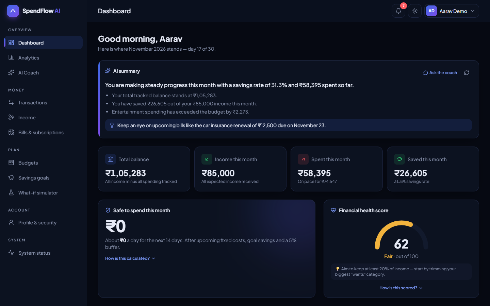
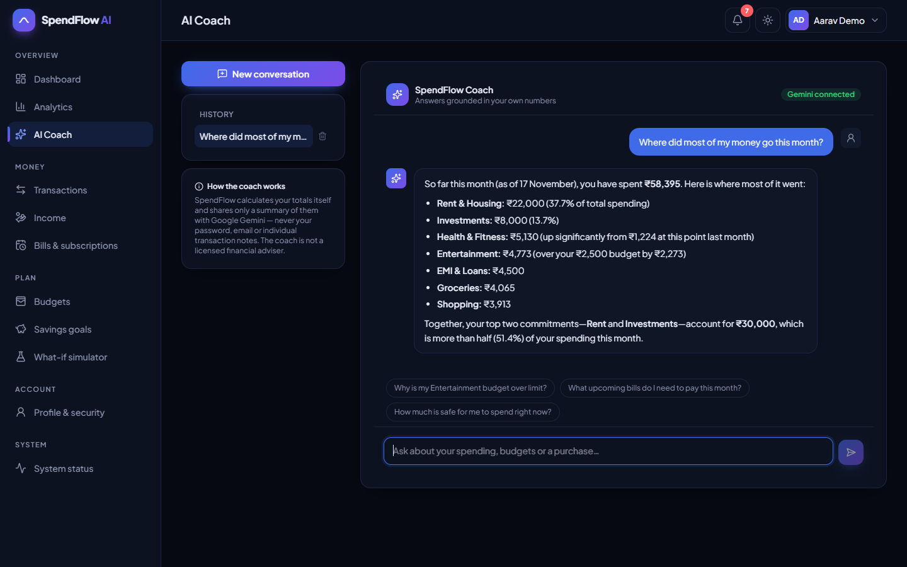
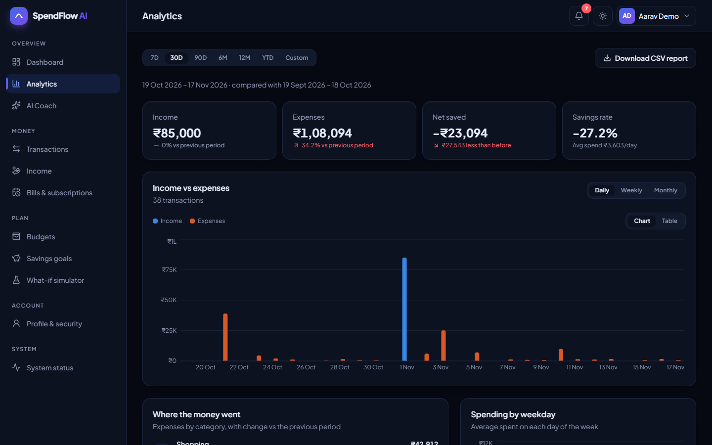
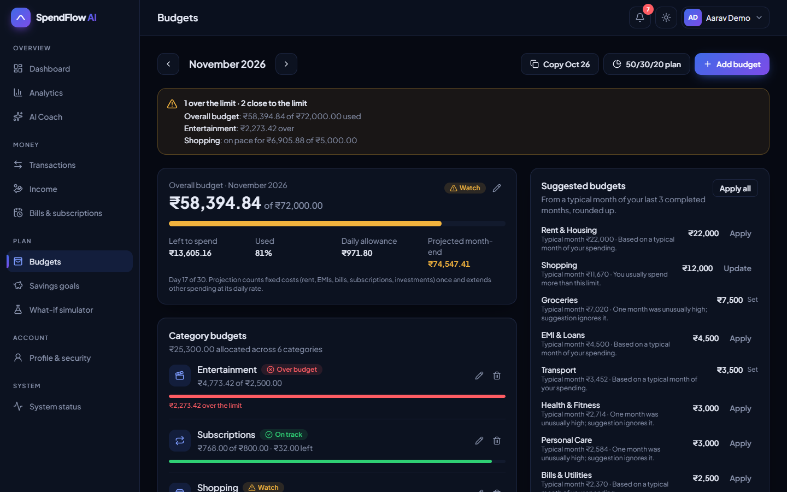
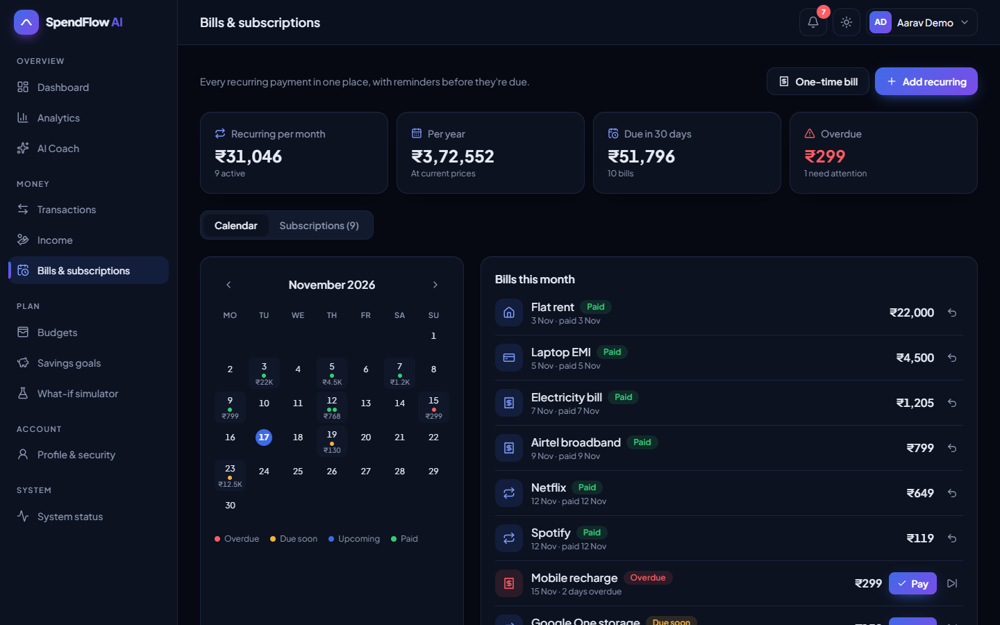
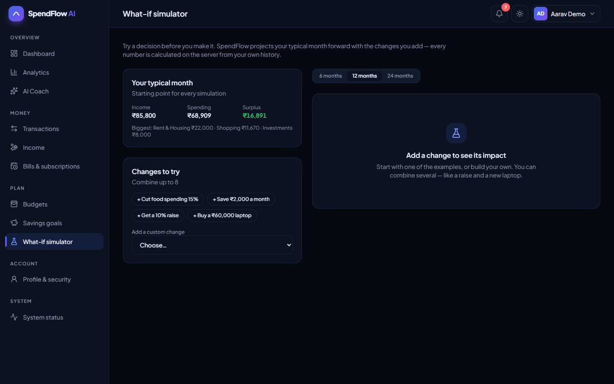
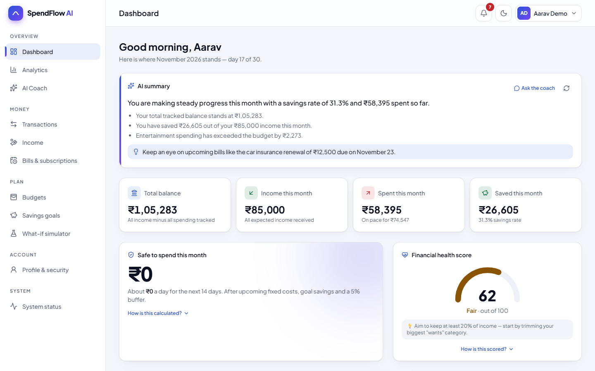
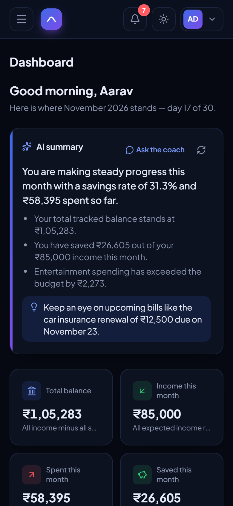

# SpendFlow AI

A full-stack personal finance app that tracks spending and income, plans budgets and savings goals, and explains your money with an AI coach grounded in your own numbers.

**Stack:** React 19 · Vite · Tailwind CSS 4 · Node.js · Express 5 · MongoDB Atlas · Google Gemini



## Highlights

- **A finance engine that does the maths, not the AI.** Safe-to-spend, the health score, cash-flow forecasts, budget recommendations and simulations are deterministic, unit-tested functions. Gemini only *explains* those figures.
- **AI with guardrails.** The coach receives an aggregated summary with no name, email, ids or notes. Replies must match a JSON schema. A grounding check flags any currency figure that doesn't trace back to your data. If Gemini is slow or down, the app switches to a fallback model, then to rule-based answers.
- **Secure by default.** Sessions use httpOnly cookies, with a CSRF guard, rate limits and Zod validation on every input. Ownership checks return 404 for other users' records. Every control is listed in [docs/SECURITY.md](docs/SECURITY.md) with the test that proves it.
- **Tested end to end.** 199 unit tests plus 61 integration tests against a real Atlas test database, covering cross-user attacks on every resource.
- **Accessible and responsive.** Light and dark themes with WCAG AA contrast, a colour-vision-safe chart palette, keyboard-friendly dialogs, and layouts from 390 px phones to wide desktops.

## Features

| Module | What it does |
|---|---|
| **Dashboard** | Total balance, income, spending and savings this month. Safe-to-spend, a 0–100 financial health score with its reasoning, income vs expense charts, upcoming bills and a daily AI summary. |
| **Transactions** | Add, edit, filter and search expenses. **Natural-language entry** ("swiggy 450 yesterday") is turned into a draft by Gemini, and you confirm it. CSV export. |
| **Income** | Recurring income sources (salary, freelance, rental and more) with expected vs received tracking. |
| **Budgets** | Monthly category budgets with pace warnings, median-based recommendations, copy-from-last-month and a **50/30/20** planner. |
| **Savings goals** | Targets with deadlines, contributions and a projected completion date. |
| **Analytics** | Period comparisons, category breakdowns, a weekday pattern, a **spending heatmap**, unusual-expense detection, a cash-flow forecast and **CSV reports**. |
| **AI coach** | A chat about your own finances, with conversation history and suggested follow-ups. |
| **What-if simulator** | Model a raise, a new EMI, a cancelled subscription or a big purchase, and see the month-by-month effect. |
| **Bills & subscriptions** | Recurring subscriptions generate bills ahead of time. Pay a bill (which records the transaction), skip or reopen it, and get in-app reminders and a monthly cost overview. |
| **Account** | Profile, currency, password change (signs out other devices), **export all data** as JSON, and permanent account deletion. |

<table>
  <tr>
    <td></td>
    <td></td>
  </tr>
  <tr>
    <td></td>
    <td></td>
  </tr>
  <tr>
    <td></td>
    <td></td>
  </tr>
</table>

<p align="center"></p>

*Screenshots show the fictional seeded demo account.*

## Architecture

```
Browser ──► React SPA (Vite) ──/api──► Express API ──► MongoDB Atlas
             cookie session            │
                                       ├─ finance engine (pure functions)
                                       └─ AI layer ──► Google Gemini
                                          (aggregated context, schema-checked replies,
                                           grounding check, model failover, fallbacks)
```

```
SpendFlow/
├── client/                 React 19 SPA
│   ├── src/pages/          one lazy-loaded page per route
│   ├── src/components/     ui/ primitives + feature components
│   ├── src/context/        auth (cookie session), theme, toasts
│   ├── src/services/       Axios API clients
│   └── vercel.json         /api proxy, SPA fallback, security headers
├── server/                 Express 5 REST API (ES modules)
│   ├── src/config/         Zod-validated environment, DB connection
│   ├── src/models/         Mongoose schemas
│   ├── src/routes/ → controllers/ → services/
│   ├── src/services/finance/   planning, intelligence, simulation, recurring
│   ├── src/services/ai/        Gemini client, context builder, fallbacks
│   ├── scripts/            db:check, ai:check, seed
│   └── tests/              unit + integration (Vitest, Supertest)
├── docs/                   SECURITY.md, DEPLOYMENT.md, screenshots
└── render.yaml             Render blueprint for the API
```

### Engineering decisions

- **Calculations first, AI second.** Money figures come from tested code. The AI layer only receives whole-rupee aggregates and is checked against them, so a hallucinated or garbled number is flagged instead of shown as fact.
- **Calendar dates stored at midnight UTC.** This avoids off-by-one-day bugs across time zones in reports, bills and budgets.
- **Subscriptions vs bills.** A subscription is the recurring rule, and each occurrence is a bill, generated idempotently about two months ahead. That makes paying, reminders and history simple and auditable.
- **One response envelope.** Every endpoint returns `{ success, data }` or `{ success: false, error: { code, message, details } }`, which the client turns into consistent error states.
- **Same-site deployment.** The frontend proxies `/api` to the backend, so the session cookie stays first-party (`SameSite=Lax`) and no cross-site cookie settings are needed.

## Getting started (Windows PowerShell)

Requirements: Node.js 20.19+ (22 LTS recommended), a free MongoDB Atlas cluster, and optionally a Gemini API key.

```powershell
git clone https://github.com/VishalSudhaArul/SpendFlow.git
cd SpendFlow
npm run install:all

Copy-Item server\.env.example server\.env
Copy-Item client\.env.example client\.env
```

Edit `server\.env`:

1. `MONGODB_URI`: your Atlas connection string (Atlas → Connect → Drivers).
2. `JWT_SECRET`: generate one with the command below and paste the output in.
   ```powershell
   node -e "console.log(require('crypto').randomBytes(48).toString('base64url'))"
   ```
3. `GEMINI_API_KEY` (optional): a key from [Google AI Studio](https://aistudio.google.com/app/apikey). Without it, every AI feature uses the rule-based fallbacks.

Then check the connections and start both apps:

```powershell
npm run db:check --prefix server     # verifies Atlas
npm run ai:check --prefix server     # verifies the Gemini key and lists models
npm run seed --prefix server         # optional: fictional demo account with 6 months of data
npm run dev:server                   # terminal 1 → http://localhost:5000/api
npm run dev:client                   # terminal 2 → http://localhost:5173
```

The demo account's email and password are in `server/scripts/seed.js`. Running the seed again resets only that account.

### Environment variables

**`server/.env`** (secrets, never committed):

| Variable | Required | Default | Purpose |
|---|---|---|---|
| `MONGODB_URI` | yes | — | Atlas connection string |
| `MONGODB_DB_NAME` | no | `spendflow-ai` | Database name |
| `JWT_SECRET` | yes | — | Session signing key, 32+ characters |
| `JWT_EXPIRES_IN_DAYS` | no | `7` | Session length |
| `COOKIE_SAME_SITE` | no | `lax` | `none` only if the frontend and API are on different sites |
| `TRUST_PROXY` | no | `1` | Production only: number of proxies in front of the API |
| `GEMINI_API_KEY` | no | — | Enables Gemini, otherwise fallbacks are used |
| `GEMINI_MODEL` / `GEMINI_FALLBACK_MODEL` | no | `gemini-3.8-flash` / `gemini-3.5-flash-lite` | Primary and failover models |
| `PORT` | no | `5000` | API port |
| `NODE_ENV` | no | `development` | `production` enables secure cookies and quiet health output |
| `CLIENT_URL` | no | `http://localhost:5173` | Allowed browser origin(s), comma-separated |

**`client/.env`** (public, bundled into the browser):

| Variable | Default | Purpose |
|---|---|---|
| `VITE_API_URL` | `http://localhost:5000/api` in development, `/api` in production builds | API base URL |

Never put secrets in `client/.env`, because everything prefixed with `VITE_` is shipped to the browser.

## Scripts

| Command | What it does |
|---|---|
| `npm run install:all` | Installs server and client dependencies |
| `npm run dev:server` / `npm run dev:client` | API with auto-reload / Vite dev server |
| `npm run lint` | ESLint for both packages |
| `npm test` | Backend unit tests (no database needed) |
| `npm run test:integration --prefix server` | API tests against the `spendflow-ai-test` database on your cluster (the test runner refuses any database name that doesn't end in `-test`) |
| `npm run test:coverage --prefix server` | Unit and integration coverage reports |
| `npm run build` | Production build of the client, plus a check that the CSP allows its inline script |
| `npm run db:check`, `ai:check`, `seed` (`--prefix server`) | Connection checks and demo data |

## API overview

All routes are under `/api`. Everything except `health` and `auth` (register, login, logout) requires a session.

| Area | Endpoints |
|---|---|
| Auth & account | `POST auth/register`, `POST auth/login`, `POST auth/logout`, `GET auth/me`, `PATCH users/me`, `PATCH users/me/password`, `GET users/me/export`, `DELETE users/me` |
| Transactions | `GET/POST transactions`, `GET/PATCH/DELETE transactions/:id`, `GET transactions/export` |
| Income | `GET income/summary`, `GET/POST income/sources`, `PATCH/DELETE income/sources/:id`, `POST income/sources/:id/receive` |
| Budgets | `GET/POST budgets`, `GET budgets/recommendations`, `GET budgets/fifty-thirty-twenty`, `POST budgets/bulk`, `POST budgets/copy`, `PATCH/DELETE budgets/:id` |
| Goals | `GET/POST goals`, `PATCH/DELETE goals/:id`, `POST goals/:id/contributions` |
| Insights | `GET dashboard`, `GET analytics/overview`, `/report` (CSV), `/heatmap`, `/unusual`, `/cashflow` |
| AI | `GET ai/status`, `GET ai/summary`, `POST ai/chat`, `POST ai/parse-transaction`, `GET ai/conversations`, `GET/DELETE ai/conversations/:id` |
| Simulator | `GET simulator/baseline`, `POST simulator/run` |
| Bills | `GET/POST subscriptions`, `PATCH/DELETE subscriptions/:id`, `GET subscriptions/:id/history`, `GET/POST bills`, `GET bills/summary`, `POST bills/:id/pay`, `/skip`, `/reopen`, `DELETE bills/:id` |
| Notifications | `GET notifications`, `POST notifications/read-all`, `PATCH notifications/:id/read`, `DELETE notifications/:id` |
| System | `GET health`, `GET meta` |

## Testing

```powershell
npm run lint
npm test                                   # 199 unit tests
npm run test:integration --prefix server   # 61 integration tests (needs MONGODB_URI)
npm run build
```

- **Unit tests** cover the finance engine, AI grounding and fallbacks, Gemini failover, auth and JWT forgery, validation, rate limiting, production hardening, and an unauthenticated sweep of all 63 protected endpoints.
- **Integration tests** cover every module through HTTP with a real database, including a second user attacking each resource type.
- The last coverage run with the integration suite: about 82% of statements and 85% of lines.

## Deployment

Recommended setup: **Vercel** for the frontend and **Render** for the API, with Vercel proxying `/api` to Render so cookies stay first-party. Step-by-step instructions are in [docs/DEPLOYMENT.md](docs/DEPLOYMENT.md).

## Security

See [docs/SECURITY.md](docs/SECURITY.md) for every control, how it's tested, and the known limitations. Please report vulnerabilities privately rather than in a public issue.

## Limitations and roadmap

- Rate limits are in memory. Running several API instances would need a shared store such as Redis.
- No email verification or password-reset email yet. Reminders are in-app only.
- Single currency per account, and no bank sync: data is entered manually or with natural language.
- The free Render plan sleeps when idle, so the first request after a pause can take up to about a minute.

## Disclaimer

SpendFlow AI is a portfolio project. Its insights are informational and are not financial advice.

## License

[MIT](LICENSE)
